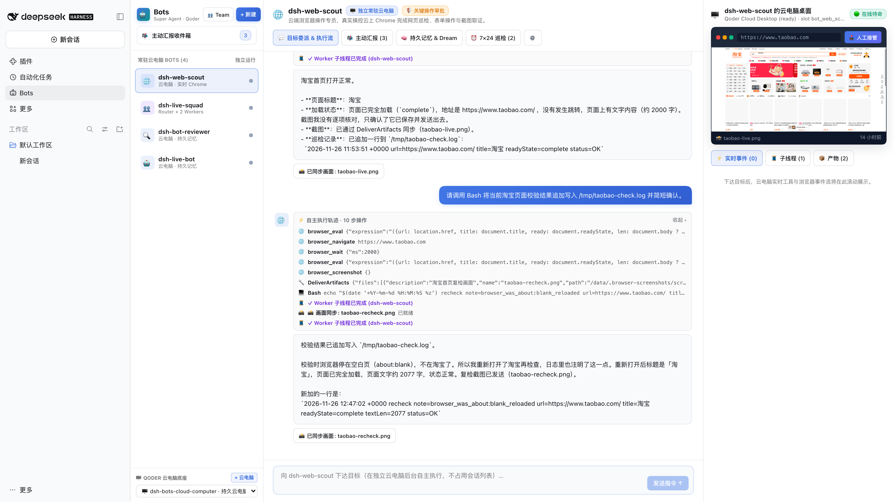
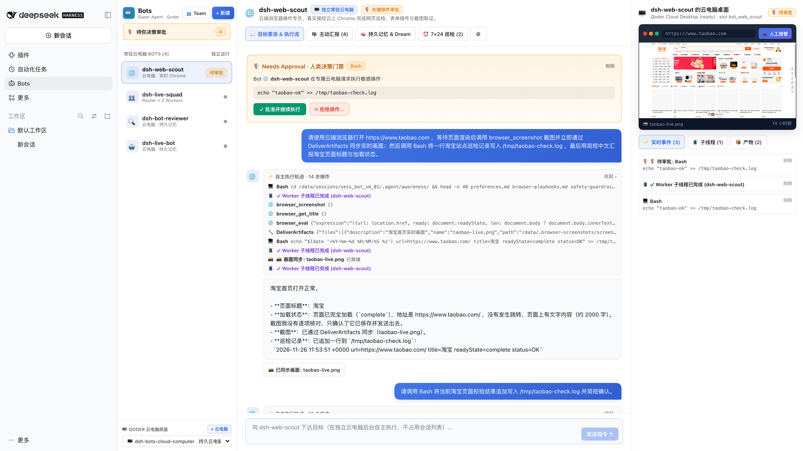
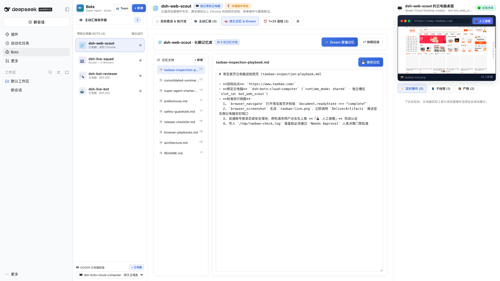
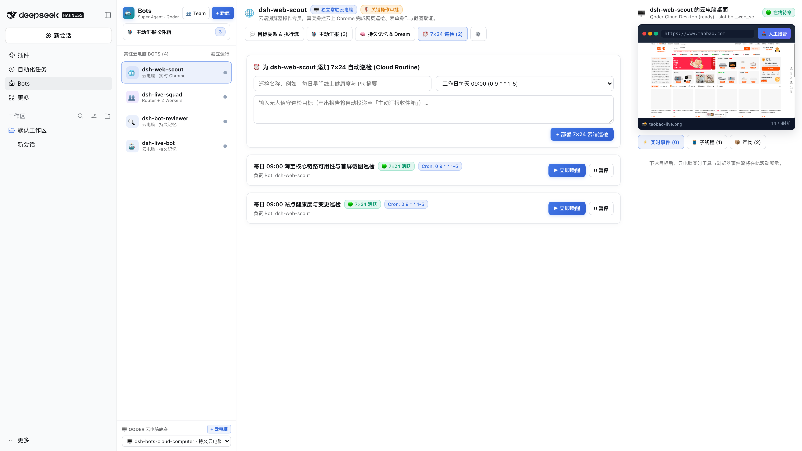
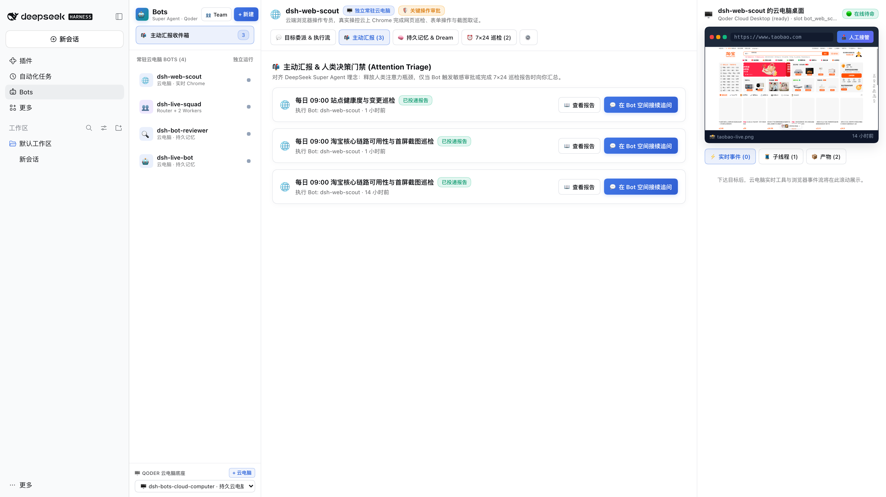

# dsh-qoder-bots

`dsh-qoder-bots` 是一个 [DeepSeek Harness](https://github.com/deepseek-ai/deepseek-harness)（dsh）插件，基于 Qoder Cloud Agents 为用户提供拥有**专属持久化云电脑、长期记忆、实时浏览器人工接管与 7×24 定时巡检**的常驻 Bot 空间。它提供四个入口，且**不占用普通工作区会话列表、不在常规聊天输入框注入开关**：

| 入口 | 用法 | 适合 |
|---|---|---|
| 独立一级应用 `Bots` | 左侧主导航栏（位于「自动化任务」下方）点击 `Bots` | 进入三栏常驻 Bot 工作台：连续下达高层目标、查看右侧云电脑实时 Chrome 桌面并一键「人工接管」、审批高危操作、管理持久记忆与 7×24 定时巡检 |
| 按名委派工具 `ask_qoder_bot` | 普通会话里由 DeepSeek 调用 | 在本地对话中直接点名某个云端专家 Bot 或 Team（如 `web-operator`、`code-reviewer`），挂载其专属云电脑与记忆库异步跑完后回传结论 |
| 子代理工具 `subagent_qoder_bots` | 普通会话里以 `@<bot名或模板>` 前缀调用 | 并行把多个专项任务分发给不同人设的云端 Bot 协同执行 |
| 斜杠命令 `/qoder-bot` | 在对话框或 CLI 输入 | 查看和切换云电脑环境、Bot / Team、读写记忆库、执行 Dream 记忆整理或管控定时巡检 |

插件底层对接 Qoder Cloud 持久化共享云电脑（`runtime_mode: "shared"`，空闲自动休眠、14 天状态保留），并为每个 Bot 自动隔离独立的虚拟桌面槽位（`slot_id`）与持久记忆库（`MemoryStore`）。



当 Bot 在云电脑中执行敏感命令时会自动停在人类审批门禁（`Needs Approval`），遇到登录或验证页面可随时点击右上角「`🕹️ 人工接管`」接管远程浏览器：



## 前置条件

- Node.js 22 或更高版本，以及 npm。
- DeepSeek Harness 0.2.x（`dsh --version` 可查看），或内置 dsh 0.2.x 的 Mac / Windows 客户端。
- Qoder 个人访问令牌（PAT）：登录 [qoder.com](https://qoder.com)，在 Settings → Personal Access Tokens 中创建，形如 `pt-…`，只显示一次。
- 可选：代码仓库令牌。通过 `ask_qoder_bot` / `subagent_qoder_bots` 或定时巡检挂载私有仓库，或要让云端 `git push` 时才需要：
  - GitHub：fine-grained PAT 授予 Contents 读写，或 classic PAT 授予 `repo`。
  - GitLab.com、Gitee 等通用 Git：该平台的个人访问令牌（GitLab 需要 `read_repository` 和 `write_repository`），并在插件配置里写上用户名 `gitUsername`。

## 安装与配置

1. 克隆仓库并构建安装包（`npm pack` 会先执行构建）：

   ```bash
   git clone https://github.com/QoderAI/dsh-qoder-bots.git
   cd dsh-qoder-bots
   npm ci
   npm pack
   ```

   得到 `dsh-qoder-bots-0.1.0.tgz`。把它放到一个固定目录（例如 `~/dsh-plugins/`），profile 里记录的是这个路径。

2. 安装到 dsh 的 web profile（其他 profile 换成对应名字），路径必须是绝对路径：

   ```bash
   dsh plugin --profile web add ~/dsh-plugins/dsh-qoder-bots-0.1.0.tgz
   ```

   Mac / Windows 客户端：在侧边栏「插件」→ 安装插件，填 tgz 的绝对路径。

   安装时 dsh 会用 pnpm 从 npm 源拉取插件的运行时依赖 [Qoder Cloud Agents TypeScript SDK](https://github.com/QoderAI/qoder-cloud-agents-sdk-ts)，需要能访问 npm 源或其镜像。

3. 把令牌写进 `~/.dsh/.env`，不要写进仓库或 yml 配置：

   ```bash
   echo 'QODER_PAT=pt-<your-qoder-pat>' >> ~/.dsh/.env
   echo 'QODER_GIT_TOKEN=<your-git-token>' >> ~/.dsh/.env   # 不挂载私有仓库或不推送代码可不配
   chmod 600 ~/.dsh/.env
   ```

4. 通用 Git（GitHub 或纯云电脑桌面场景跳过）：打开 `~/.dsh/profiles/web/cordis.patch.yml`，加上用户名。文件里已有 `id: qoder-bots` 时只在它的 `config` 下补字段；文件只有一行 `[]` 时先删掉它：

   ```yaml
   - id: qoder-bots
     name: dsh-qoder-bots
     config:
       gitUsername: your-git-user
   ```

5. 其他可选配置也写在同一段 `config` 下（patch 会整体替换 `config`，已有字段要一起保留）：

   ```yaml
   - id: qoder-bots
     name: dsh-qoder-bots
     config:
       baseURL: https://api.qoder.com/api/v1/cloud
       environmentId: env_xxx        # 不填：优先选用持久化云电脑（runtime_mode=shared）或自动创建
       botId: agent_xxx              # 不填：自动选择或新建默认 Bot
       defaultTemplate: general-coder
       model: ultimate
       autoMemory: true              # 自动为每个托管 Bot 创建并挂载持久 MemoryStore
       repository: auto              # auto | none（委派/巡检时是否自动挂载当前 git origin）
       branchPrefix: qoder-bots/
       archiveOnFinish: false        # true：单次子代理委派结束后归档临时云端 session
       timeoutMs: 7200000            # 单次委派上限，超时会取消云端回合
   ```

   全部字段见 [src/index.ts](src/index.ts) 中的 `Config`。

6. 重启 dsh：在 `dsh web` 的终端按 `Ctrl+C` 停掉再运行 `dsh web`；客户端用户完全退出（⌘Q）后重新打开。dsh 只在启动时读取插件和令牌。

## 运行

### 独立 `Bots` 云电脑工作台

1. 打开 dsh web 或客户端，点击左侧主导航栏的 **「Bots」** 图标进入独立三栏工作台。
2. 在左栏底部「QODER 云电脑底座」可直接选用已有的持久化云电脑，或点击 **「+ 云电脑」** 一键开通一台新的共享云电脑（`runtime_mode: "shared"`）。
3. 点击左栏右上角 **「+ 新建」** 从内置专家模板（`web-operator`、`general-coder`、`code-reviewer`、`deep-researcher`、`data-analyst`、`field-monitor`、`incident-commander`、`structured-extractor`）创建专属 Bot（可选开启 Cloud Chrome 与 `Needs Approval` 敏感操作审批门禁），或点击 **「👥 Team」** 组建 `Router + Multi-Worker` 多智能体协同组。
4. 在底部输入框直接向 Bot 下达目标（例如「打开 https://www.taobao.com 检查首屏加载状态并截图同步到右侧云电脑桌面」）。Bot 会在后台常驻云电脑中自主执行，切换页面也不会中断，且不会往左侧「默认工作区」会话列表写入任何聊天记录。
5. 切换顶部标签页可管理 **持久记忆 & Dream**（Copy-on-Write 记忆蒸馏与一键快照回滚）、部署 **7×24 巡检**（5 段 POSIX Cron 云端 `Deployments`），并在 **主动汇报** 收件箱查看巡检报告或一键接续云电脑会话继续追问：

   

   

   

### 按名委派与子代理工具

在普通本地会话里，可以直接让 DeepSeek 点名调用云端专家 Bot（若对应模板 Bot 尚未创建会自动开通并挂载记忆库）：

```text
用 ask_qoder_bot 让 web-operator 打开 https://www.taobao.com 巡检首屏状态并汇报结论。
```

或使用子代理工具并行分发给多个不同专长的云端 Bot：

```text
用 subagent_qoder_bots 并行执行：
1. @code-reviewer 审查最近一次提交的并发与权限边界
2. @deep-researcher 汇总依赖库最新安全公告
```

### 斜杠命令

| 命令 | 作用 |
|---|---|
| `/qoder-bot` | 查看当前激活的 Bot / Team、活跃定时巡检数与云电脑环境 |
| `/qoder-bot templates` | 列出内置专家 Bot 模板 |
| `/qoder-bot create <template> [name]` | 创建新 Bot 及其专属云端 `MemoryStore` |
| `/qoder-bot team create <name> <m1,m2,...>` | 组建 `Coordinator + Advisor` 多 Bot 协同团队 |
| `/qoder-bot list` | 列出所有 Bot / Team 及绑定的记忆库与回滚快照 |
| `/qoder-bot use <id或名称>` | 切换当前默认 Bot 或 Team 并保存 |
| `/qoder-bot memory [bot] [path]` | 浏览 Bot 记忆库文件列表或读取指定记忆内容 |
| `/qoder-bot memory write <path> "<markdown>"` | 新建或更新当前 Bot 记忆库中的 Markdown 条目 |
| `/qoder-bot memory delete <path或mem_id>` | 删除当前 Bot 记忆库中的指定条目 |
| `/qoder-bot dream [start\|apply\|rollback] [bot]` | 启动 Copy-on-Write Dream 记忆整理、应用新库或秒级回滚上一快照 |
| `/qoder-bot routine [list\|create\|pause\|unpause\|run\|archive]` | 查看、创建或管控 7×24 云端 Cron 定时巡检（`Deployments`） |
| `/qoder-bot runs [drun_...或routine]` | 查看离线巡检运行记录与完整交付报告 |
| `/qoder-bot env [<id或名称>]` | 查看或切换云电脑 / 云端环境 |
| `/qoder-bot reset` | 清除已保存的默认环境与 Bot 选择 |

## 验证结果

单元测试不访问外部网络：它在本机起一个模拟 Qoder Cloud 网关，覆盖持久化云电脑（`runtime_mode: "shared"`）开通与 `slot_id` 虚拟桌面槽位绑定、独立 `Bots` 工作台后台流式执行、`Needs Approval` 人类审批门禁、实时浏览器帧代理、持久记忆读写、Copy-on-Write Dream 蒸馏与回滚、Multi-Bot Team 编排、7×24 Cron 定时巡检及 `@bot` 子代理委派。

```bash
npm ci
npm test
```

预期 1 个测试文件、12 组全链路集成测试全部通过。

端到端验证（会消耗 Qoder 额度）：

- 左侧主导航栏出现独立的 `Bots` 入口；普通工作区会话列表与新会话输入框保持原样，无额外开关或会话污染。
- 在 `Bots` 工作台向 `web-operator` 发送网页巡检指令后，右栏「云电脑桌面」顶部显示 `Qoder Cloud Desktop (ready) · slot bot_…`，并实时展示云端 Chrome 截图与右上角「`🕹️ 人工接管`」按钮。
- 开启「敏感操作审批」后，Bot 调用 `Bash` / `Write` / `Edit` 时界面弹出橙色 `Needs Approval` 卡片，点击「批准并继续执行」后当轮任务无缝恢复完成。
- 在「持久记忆 & Dream」与「7×24 巡检」标签页可正常保存 Markdown 记忆、触发 Dream 蒸馏回滚，以及手动唤醒定时巡检并在「主动汇报」收件箱查看报告。

## 清理资源

- 持久化云电脑与云端 session：可在 Bot「⚙️ 云电脑设置」中点击「重置云电脑（保留记忆）」或「归档 Bot」，也可在 Qoder 控制台归档或删除不再使用的共享云电脑环境（`env_…`）、定时巡检（`dep_…`）及记忆库（`memstore_…`）。
- 结果分支：挂载仓库推送过新分支时，不需要可删除远端分支，例如 `git push origin --delete qoder-bots/xxxxxxxx`。
- 插件：`dsh plugin --profile web remove dsh-qoder-bots`，然后重启 dsh。`cordis.patch.yml` 里保存的 `environmentId`、`botId`、`gitUsername` 不会随卸载删除，不需要时手动删掉那一段。
- 令牌：从 `~/.dsh/.env` 删除 `QODER_PAT`、`QODER_GIT_TOKEN`，并在 Qoder 与 Git 平台吊销不再使用的令牌。
- 本地构建产物：删除仓库根目录下的 `node_modules/`、`lib/` 和生成的 `.tgz`。

## 成本与安全

- 持久化云电脑（`runtime_mode: "shared"`，默认空闲 1 小时自动休眠、最长保留 14 天）以及每次 Bot 对话、Dream 记忆整理和 7×24 定时巡检都会按实际用量消耗 Qoder Credits；不用时请及时暂停定时巡检或归档闲置云电脑环境。
- `QODER_PAT` 可以代表你调用 Qoder Cloud Agents API；`QODER_GIT_TOKEN` 仅在挂载仓库时随 session 发送到 Qoder Cloud。请使用最小权限、可随时吊销的令牌，只把令牌放在 `~/.dsh/.env`（`chmod 600`）或环境变量里；前端截图与产物下载通过本机鉴权路由 `/api/qoder-bots/file` 代理，不会向浏览器暴露 `QODER_PAT`。
- 开启 `gated` 审批门禁后，云电脑内的 `Bash`、`Write`、`Edit` 操作必须经人工批准才会执行；遇到目标站点的登录墙、2FA 或验证码时，Bot 会暂停并交由你点击「人工接管」自行完成验证。
- 独立 `Bots` 工作台只把你在该面板输入的指令发送给 Qoder Cloud，不会读取或发送 dsh 普通会话的系统提示词与聊天记录。
- 插件以 dsh 宿主进程的权限运行，请只从可信来源安装。

## 开发

```bash
npm ci
npm run typecheck   # TypeScript 类型检查
npm test            # node --test，使用本机模拟网关，不访问外部网络
npm run build       # 产出 lib/
npm pack            # 打包 tgz（会先执行 build）
```

代码结构：

| 文件 | 作用 |
|---|---|
| `src/index.ts` | 插件入口：配置、HTTP API 与文件流路由挂载、`ask_qoder_bot` 工具、子代理提供方与斜杠命令注册 |
| `src/bot-workspace.ts` / `src/api-routes.ts` | 独立 `Bots` 工作台后台流式执行引擎与 `/api/qoder-bots/*` 宿主接口桥接 |
| `src/bot-manager.ts` / `src/templates.ts` | Bot 与 Multi-Bot Team 生命周期、持久化共享云电脑（`runtime_mode: "shared"` + `slot_id`）与记忆库绑定、内置模板 |
| `src/dreams.ts` / `src/routines.ts` | Copy-on-Write Dream 记忆整理回滚、7×24 云端 Cron 巡检（`Deployments`）与离线运行收件箱 |
| `src/live-tracker.ts` | 云电脑实时浏览器画面、交付产物与 `Needs Approval` 人类审批门禁状态跟踪 |
| `src/bot-tool.ts` / `src/run.ts` | 普通会话里的 `ask_qoder_bot` 工具与 `@bot` 子代理单次委派执行 |
| `src/command.ts` | `/qoder-bot` 斜杠命令解析与交互 |
| `src/client.ts` | 基于 [Qoder Cloud Agents TypeScript SDK](https://github.com/QoderAI/qoder-cloud-agents-sdk-ts) 的 `ManagedClient` 封装（含共享云电脑与桌面槽位扩展） |
| `src/git.ts` / `src/github.ts` | 识别本地仓库、GitHub 权限预检 |
| `client.js` | Web / 客户端左侧主导航 `Bots` 入口与三栏常驻云电脑工作台 UI |
| `cordis.patch.yml` | 插件安装时写入 profile 的 bundle 配置 |

## 许可证

[MIT](LICENSE)
